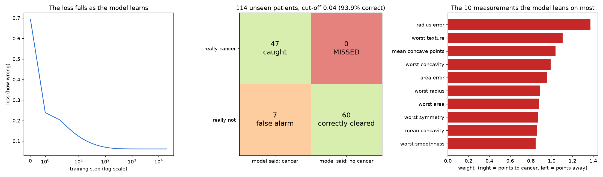

# Logistic regression from scratch

A yes/no classifier written in plain NumPy, with no machine-learning library doing the work.
It predicts whether a breast tumour is cancerous from 30 measurements of its cells.



## Result

Tested on 114 patients the model never saw during training:

| | Cut-off 0.50 (default) | Cut-off 0.044 (chosen) |
|---|---|---|
| Cancers caught | 44 of 47 | 47 of 47 |
| Cancers missed | 3 | 0 |
| False alarms | 0 of 67 | 7 of 67 |
| Accuracy | 97.4% | 93.9% |

At the default cut-off, the same data run through scikit-learn's `LogisticRegression` gives
the same 97.4%, the same prediction for every patient, and the same weights to five decimal places.

## Why the cut-off was lowered

The default rule says "cancer" above 50%, which treats a missed cancer and a false alarm
as equally bad. A missed cancer is worse, so the cut-off was lowered until the model caught
at least 99% of cancers.

The cut-off was chosen using training patients only, with 5-fold cross-validation, so the
test patients stayed untouched until the final score. Accuracy went down and the model got
more useful: the three cancers it used to miss are now flagged, and 7 healthy patients get
a follow-up they did not need.

## How it works

1. **Guess.** Multiply each measurement by a weight, add them up, and squash the total
   through the sigmoid to get a probability between 0 and 1.
2. **Score.** Cross-entropy loss measures how wrong the guesses are. It punishes
   confident wrong answers hardest.
3. **Nudge.** The direction to move each weight is the prediction minus the truth,
   multiplied by the input. Move a small step that way.
4. **Repeat** 20,000 times.

A small penalty on large weights (L2 regularization) stops the model becoming overconfident.

## Files

- `logistic_regression.py`: the first version, on 400 made-up students (pass or fail). Includes a check that the gradient formula matches a brute-force measurement.
- `real_data.py`: the same model on the Breast Cancer Wisconsin (Diagnostic) dataset, with the scikit-learn comparison.

## Run it

```powershell
python real_data.py
```

## Limits

- One fixed 80/20 split of 569 patients. With only 114 test patients, one extra mistake moves accuracy by about 1%.
- Catching 47 of 47 here does not mean it would catch every cancer. In rehearsal on training patients the same cut-off caught 99.4%, with a 13% false-alarm rate.
- The 99% target is a judgement call. A hospital would set it from the real cost of each kind of mistake.
- This is a learning project, not a medical tool.

## Data

Breast Cancer Wisconsin (Diagnostic), W. Wolberg, O. Mangasarian, N. Street and W. Street, 1993, UCI Machine Learning Repository. Loaded through `sklearn.datasets.load_breast_cancer`.
