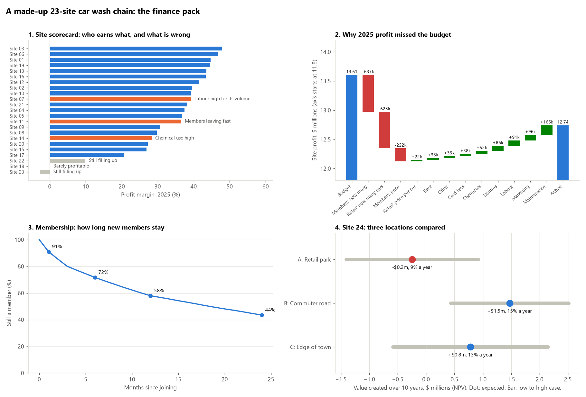

# Finance pack for a 23-site car wash chain

The work a financial analyst does for a multi-site business, end to end: which sites earn their keep, why profit
missed the budget, what a member is worth, what next year looks like, and where to build the next site.

> **All the data is made up.** `make_data.py` invents the chain. No real company, site or customer is involved.
> A few problems are planted in the data on purpose, so the analysis can be checked: did it find them?

**[Open the interactive dashboard](https://aopejf.github.io/ml-from-scratch/finance/)** &nbsp;|&nbsp;
**[Read the one-page memo](MEMO.md)** &nbsp;|&nbsp; **[Download the Excel model](car_wash_finance_model.xlsx)**



## What it found

The chain made $35.1m of revenue in 2025 and $12.7m of site profit (36%), $864k below budget.

**1. Site scorecard.** Every planted problem was found, with a dollar figure on the ones that can be fixed:

| Site | Finding | Worth |
|---|---|---|
| 07 | Labour is 25% of revenue; sites of its volume run near 19% | About $120k a year |
| 14 | Chemical cost per car jumped by half in June 2025 | About $37k a year |
| 11 | Members cancelling at 1.5 times the chain's rate since a competitor opened | Missed budget by $189k |
| 18 | Has lost money three years running | |
| 22, 23 | Flagged as "still filling up", not as failing: they opened in the last two years | |

**2. Budget against actual.** The $864k miss splits into pieces that add up exactly: fewer members than planned
(-$637k), fewer retail cars (-$623k), the price rise arriving two months late (-$222k), and costs under budget (+$594k).

**3. Membership.** 61,339 members paying $30.81 a month: $1.89m of recurring revenue each month, 62% of all revenue.
3.1% cancel each month, and 58% of new members are still there a year later. A new member is worth about $771
and costs about $54 in marketing to win.

**4. Forecast.** 2026 revenue of $36.7m, up 4.4%. Tested on a year it had not seen, monthly car counts were off by
4.8%, against 5.7% for the simple rule "same as this month last year".

**5. Site 24.** Build at location B. It creates $1.5m of value at a 15% yearly return, and still clears the 10%
bar if volume comes in low. Location A has the most traffic but three competitors, and falls short.

## The three things to open

| | What it is | Why it is there |
|---|---|---|
| [Dashboard](https://aopejf.github.io/ml-from-scratch/finance/) | One page: click any site for its history, switch the budget bridge to one site, move sliders to test the site 24 decision | For people who will not open a spreadsheet |
| [`car_wash_finance_model.xlsx`](car_wash_finance_model.xlsx) | The same work in Excel with live formulas. Blue cells are assumptions: change one and the answer moves | Finance teams work in Excel |
| [`MEMO.md`](MEMO.md) | One page to the CFO: the recommendation, the reasons, and what I am less sure of | The point of analysis is a decision |

## Terms

| Term | Plain meaning |
|---|---|
| Site profit (four-wall EBITDA) | What a site earns before head-office cost, interest, tax and depreciation |
| Margin | Profit as a share of revenue |
| Variance | The gap between budget and actual |
| Churn | The share of members who cancel in a month |
| LTV (lifetime value) | What one new member is worth over their whole stay |
| CAC (customer acquisition cost) | Marketing spent per new member |
| NPV (net present value) | Future cash discounted back to today, minus the build cost. Above zero beats the required return |
| IRR (internal rate of return) | The yearly return the project itself earns |
| Payback | Years of cash needed to earn back the build cost |

## How each part works

1. **Scorecard** (`finance.scorecard`). Adds up each site's year. To judge labour fairly it fits a line across all
   sites (labour needed for a given number of cars) and flags sites more than 15% above it, so a busy site is not
   punished for being busy. Sites open under two years are labelled, not judged.
2. **Budget against actual** (`finance.variance`). For each revenue line: the volume effect is
   (actual units - budget units) x budget price, and the price effect is (actual price - budget price) x actual units.
   Costs are budget minus actual. A test confirms the pieces sum to the profit gap to the cent.
3. **Membership** (`finance.membership`). LTV = monthly margin per member / monthly churn. The margin takes off the
   cost of the washes a member uses, measured from how costs move with volume. The retention curve follows each
   month's joiners.
4. **Forecast** (`finance.forecast`). Built from parts: members next month = members now - cancellations + joins;
   retail cars = the site's recent level x the usual seasonal pattern. `finance.backtest` hides 2025 and scores it.
5. **Site 24** (`finance.site24`). A regression on the 20 established sites predicts yearly washes from traffic,
   competitors and income. That volume goes through ten years of cash flows (a slow first two years, 2% yearly
   growth, equipment replacement, a sale value), discounted at 10%. Low and high cases come from how far off the
   volume prediction usually is.

## Checked three ways

- **Tests.** `tests/test_finance.py`: NPV, IRR and payback against known answers; the budget bridge adds up; the
  planted problems are found; the forecast cannot see the year it is tested on.
- **Excel against Python.** `check_excel.ps1` opens the workbook in Excel, switches through all nine site 24 cases
  and compares 45 values with the Python results. All agree.
- **JavaScript against Python.** The dashboard sliders redo the investment sums in the browser (`site24.js`).
  `tests/check_site24.js` confirms they match Python.

## SQL

[`queries.sql`](queries.sql) answers five finance questions against the same data as a SQLite database, using
window functions (`RANK`, `LAG`, rolling sums) and common table expressions. Answers are in
[`queries_output.md`](queries_output.md). The early-warning query finds site 11 with no model at all.

## Run it

```powershell
python make_data.py
```

```powershell
python analysis.py
```

```powershell
python build_excel.py
```

```powershell
python run_queries.py
```

Needs `xlsxwriter` as well as the packages from the main README: `python -m pip install xlsxwriter`.
To open the dashboard on your own computer, open `dashboard.html` in a browser after running `analysis.py`.

## Files

- `make_data.py`: invents the chain and writes `data/`.
- `finance.py`: every calculation, as plain functions.
- `analysis.py`: runs them, prints the findings, writes `results.json`, `data.js` and `result.png`.
- `build_excel.py`, `check_excel.ps1`: write the Excel model and check it in Excel.
- `dashboard.html`, `site24.js`: the interactive page.
- `queries.sql`, `run_queries.py`, `queries_output.md`: the SQL.
- `MEMO.md`: the one-page recommendation.

## Limits

- The data is made up, so this shows the method, not facts about any real chain. Real books are messier: late
  invoices, sites that are owned instead of leased, one-off items. The planted problems are also cleaner than real ones.
- The site 24 volume model fits very well (it explains 93% of the differences between sites) because I wrote the rule
  that generated the data. On real sites expect a much looser fit and wider low and high cases.
- About a third of site 24's cash value is the assumed sale value after ten years. With no sale value, location B
  falls $0.5m short of the 10% bar. The memo says so.
- A new site taking customers from nearby sites of the same chain is not modelled.
- Costs in the budget comparison are not adjusted for volume: part of the $594k "saving" is only because fewer cars were washed.
- The forecast beats the simple rule by a small margin, and weather it cannot know moves a month by several percent.
- CAC counts all marketing as the cost of winning members and ignores opening discounts, so 14 to 1 is flattering.
- Tax, loans and depreciation are left out throughout.
