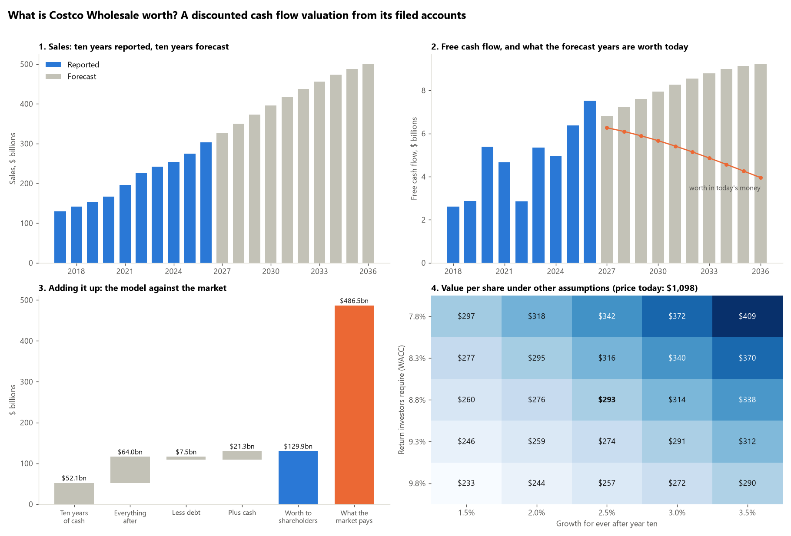

# What is a company worth? A valuation from its filed accounts

A discounted cash flow (DCF) valuation of Costco Wholesale, built from the figures the company files with the US
regulator. It forecasts the cash the business will produce, works out what that cash is worth today, and compares
the answer with the share price. Then it turns the question round: what would have to be true for the price to be right?

> **This is a worked method, not advice to buy or sell anything.** The figures are real and public. The
> assumptions are mine, and the page lets you change every one that matters.

**[Open the interactive valuation](https://aopejf.github.io/ml-from-scratch/valuation/)** &nbsp;|&nbsp;
**[Download the Excel model](company_valuation_model.xlsx)**



## What it found

Figures as of 23 November 2026, financial year 2026.

**1. The business.** Sales of $303.2bn, operating profit of $11.7bn (3.9% of sales), free cash flow of $7.5bn.

**2. The return investors require.** Government bonds pay 4.92%. The share moves about 0.81% when the market moves
1% (its beta). That gives shareholders a required return of 8.9%, and 8.8% once the company's small amount of cheap
debt is blended in (the WACC).

**3. The valuation.** With sales growth starting at 7.8% (the last three years' average) and fading to 2.5%, and
the profit margin held at 3.8%:

| | |
|---|---|
| Ten years of cash, in today's money | $52.1bn |
| Everything after year ten, in today's money | $64.0bn (55% of the total) |
| Whole business | $116.1bn |
| Less debt, plus cash | -$7.5bn, +$21.3bn |
| Worth to shareholders | $129.9bn |
| **Value per share** | **$293** |
| Share price | $1,098 |

**4. How sure?** Not very, and the model says so. Moving the required return by one point either way and the
for-ever growth rate by one point gives $233 to $409 a share. A cautious story gives $222, an optimistic one $378.
None of them reaches the price.

**5. What the price assumes.** To be worth $1,098 on this model, holding everything else still, you would need
one of:

- sales growth starting at 42% a year, not 7.8%, or
- a profit margin of 11.5%, not 3.8%, or
- investors accepting a return of 4.1% a year, less than government bonds pay.

The market pays 53 times last year's profit. The plain reading is not "the market is wrong". It is that buyers
are paying for something a ten-year cash forecast does not capture: very steady membership income, the expectation
that the business keeps growing for far longer than ten years, and a willingness to accept a low return for
safety. The model's job is to make that gap visible and put numbers on it.

## The two things to open

| | What it is | Why it is there |
|---|---|---|
| [Interactive page](https://aopejf.github.io/ml-from-scratch/valuation/) | Four sliders: growth, margin, required return, for-ever growth. The value per share, the charts and the sensitivity table update as you move them | To answer "what if you are wrong about X?" on the spot |
| [`company_valuation_model.xlsx`](company_valuation_model.xlsx) | The same model in Excel with live formulas. Blue cells are assumptions: change one and the answer moves | Finance teams work in Excel |

## Terms

| Term | Plain meaning |
|---|---|
| Free cash flow | Cash left after tax and after paying for buildings, equipment and stock. What the owners could take out |
| Discounting | Shrinking future cash to what it is worth today, because money later is worth less than money now |
| DCF (discounted cash flow) | Valuing a business as the sum of all its future free cash flow, discounted |
| Beta | How much the share moves when the whole market moves 1% |
| Cost of equity (CAPM) | The return shareholders require: government bond yield + beta x the extra return shares pay over bonds |
| WACC (weighted average cost of capital) | The blended return required by shareholders and lenders together |
| Terminal value | The worth of every year after the forecast ends, from one formula |
| Enterprise value | The value of the whole business, before taking off debt and adding cash |
| Sensitivity table | The answer recalculated under other assumptions, laid out as a grid |
| Reverse DCF | Starting from the share price and solving for the assumption that produces it |

## How it works

1. **Get the figures** (`fetch_data.py`). Ten years of sales, profit, tax, capital spending, debt and cash from
   the regulator's public database (SEC EDGAR), monthly share prices, and the ten-year government bond yield. No
   account or password is needed for any of them. The saved copies are in `data/`.
2. **The required return** (`valuation.cost_of_capital`). Beta is the slope of the share's monthly returns against
   the S&P 500 over five years. Cost of equity = bond yield + beta x 5%. The 5% is an assumption, and a common one.
3. **The forecast** (`valuation.dcf`). Sales grow at a rate that fades in a straight line from recent growth to
   2.5%. Each year: operating profit, less tax, plus depreciation, less spending on buildings and equipment, less
   the change in working capital. That is free cash flow.
4. **Everything after year ten.** Year eleven's cash divided by (required return - growth). A test confirms that a
   company growing at one steady rate gets exactly the textbook answer, whether you forecast 5 years or 20.
5. **To a share price.** Add the pieces, take off debt, add cash, divide by the number of shares.
6. **Reverse it** (`valuation.implied`). Search for the growth, margin or return that makes the model equal the price.

## How it is checked

- **Against known answers.** 9 tests in [`tests/test_valuation.py`](../tests/test_valuation.py): the textbook
  formula, the pieces adding up, value moving the right way when an assumption moves, and the reverse valuation
  really landing on the share price.
- **Against the company's own cash-flow statement.** The free cash flow built here is within range of what the
  company reports.
- **Three versions agree.** The model exists in Python, in Excel and in JavaScript (the web page). A script opens
  the workbook in Excel and compares 53 values with Python. Another compares 45 values from the page's code.

## Honest limits

- **55% of the value sits after year ten**, in one formula with two inputs. That is normal for a DCF and is the
  main reason the answer is a range, not a number.
- The margin is held flat. If membership fees grow faster than sales, it would rise.
- The 5% extra return for shares is an assumption. At 4% the value rises to about $331 a share, still nowhere near the price.
- Beta from five years of monthly prices is a noisy estimate.
- Leases are not counted as debt, and share-based pay is not taken off. Both would lower the value a little.
- One company, one date. The figures go stale; run `fetch_data.py` to refresh them.

## Run it

```powershell
python fetch_data.py
```

```powershell
python analysis.py
```

```powershell
python build_excel.py
```

`fetch_data.py` needs the internet and `yfinance`. The other two work from the saved files in `data/`.
To value a different company, change `COMPANY` at the top of `fetch_data.py`. Companies that label their accounts
differently may need a line added to `LINES`.

## Files

- `fetch_data.py`: downloads the figures and writes `data/`.
- `valuation.py`: every calculation, as plain functions.
- `analysis.py`: runs them, prints the findings, writes `results.json`, `data.js` and `result.png`.
- `build_excel.py`, `check_excel.ps1`: write the Excel model and check it in Excel.
- `page.html`, `dcf.js`: the interactive page.
