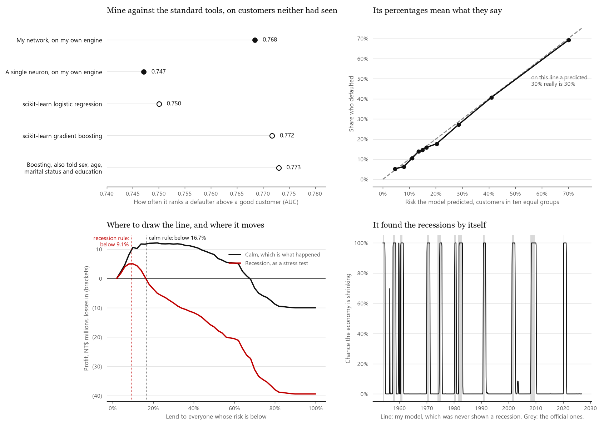

# Who will miss their next payment?

A bank in Taiwan published the records of 30,000 credit card customers: what they owed, what they paid, how late
they were, and whether they missed the next payment. About one in five did.

I trained a model to see it coming. Then I worked out what a lender should do with the score, and what should
change when a recession arrives. The learning runs on the [autograd engine from project 2](../2_autograd) and the
[Adam optimizer from project 1](../1_optimizers), both of which I wrote by hand earlier in this repository. No
machine-learning library does the learning.

[Open the interactive page](https://aopejf.github.io/ml-from-scratch/loans/)



This is a worked method. The customer data is real and public. The profit and loss rates are my assumptions, and
you can change them on the page.

## How good the model is

Take one customer who defaulted and one who paid. The model gives the defaulter the higher risk 77 times in 100,
on 6,000 customers it never saw during training (AUC 0.768, Gini 0.54, KS 0.42).

| Model | AUC |
|---|---|
| My network, on my own engine | 0.768 |
| A single neuron, on my own engine | 0.747 |
| scikit-learn logistic regression | 0.750 |
| scikit-learn gradient boosting | 0.772 |
| Gradient boosting, also told sex, age, marital status and education | 0.773 |

Logistic regression is the scorecard banks have used for decades, and gradient boosting is usually the strongest
choice. My network has 97 adjustable numbers and comes within half a point of it. The last row was given the
personal details a lender is not allowed to use. They added almost nothing.

The percentages hold up too. Of the customers the model puts at about 30% risk, about 30% default. I checked
this because the lending rule below compares the model's percentage with a break-even percentage, so the
percentages have to mean what they say.

## From a score to a decision

Suppose a customer who pays earns the lender 15% of their balance in a year, and one who defaults costs 75% of
it. Lending then pays only while the risk is under 15 / (15 + 75) = 16.7%. Here is that rule on the 6,000 test
customers, who owed NT$309m between them.

| Rule | Approved | Result |
|---|---|---|
| Lend to everyone | 100% | NT$10.0m loss |
| Lend below 16.7% risk | 56% | NT$11.5m profit |
| Lend only to those who went on to pay, which nobody can know in advance | 78% | NT$36.9m profit |

Of the customers the rule approves, 11% defaulted. Of those it declines, 36% did.

## Knowing when a recession has started

Official recession dates are announced about a year late, which is no use to a lender. So I built a second model
and did not tell it what a recession is. Each month it sees three figures for the US economy: the change in
unemployment, in jobs and in factory output. Its only instruction is to sort every month since 1953 into three
moods.

One of the moods it found is plainly "shrinking". That mood covers all 11 official recessions, raises one false
alarm, and agrees with the official record in 89% of months.

## What changes in a recession

US banks wrote off 3.8% of card debt a year in calm times and 5.7% in and just after recessions, which is 1.48
times as much. I applied that multiplier to every customer's risk.

| In a recession | Approved | Expected result |
|---|---|---|
| Keep lending below 16.7% | 56% | NT$0.3m loss |
| Fall back to lending below 9.1% | 18% | NT$5.1m profit |

A customer who scores 9.1% in calm times reaches the 16.7% break-even once defaults multiply, so 9.1% becomes
the line. On this book the stricter rule is worth NT$5.3m. The detector's latest reading, for October 2026, puts
the chance of "shrinking" near 0%, so the calm rule is the one in use.

## Why a customer got their score

A lender who turns someone down has to say why. The engine that trained the model can also be pointed at one
customer and asked how much each fact about them moved their risk away from the average customer's. The pieces
add up exactly to the score. The page shows them for three customers.

## Official terms

| Plain English | Official term |
|---|---|
| Chance of missing the next payment | Probability of default (PD) |
| Share of the balance lost when they do | Loss given default (LGD) |
| Risk x loss x balance | Expected loss |
| How well the model ranks customers | AUC, Gini, KS |
| Whether the percentages match reality | Calibration |
| The hidden mood of the economy | Regime, in a Markov regime-switching model (a hidden Markov model) |
| Making every customer riskier to see what breaks | Stress test |
| Why this customer got this score | Reason codes, here by integrated gradients |
| Details the model must not use | Protected characteristics |

## What is in the folder

| File | What it does |
|---|---|
| [`fetch_data.py`](fetch_data.py) | Downloads the customers (UCI) and the US economy and card-loss figures (FRED) |
| [`loan.py`](loan.py) | The ten facts the model reads, the training loop on my engine, the scoring, the lending sums and the reasons |
| [`train.py`](train.py) | Trains a single neuron and a small network, keeps the better one and saves `weights.json` |
| [`recession.py`](recession.py) | The recession detector, a three-mood hidden Markov model written in NumPy |
| [`analysis.py`](analysis.py) | Scores everything, runs the stress test, and writes the chart and the page's data |
| [`policy.js`](policy.js), [`page.html`](page.html) | The interactive page, with the same lending sums in JavaScript |

Project 2's engine (`2_autograd/engine.py` and `nn.py`) builds the network and works out every adjustment by
backpropagation. Pointed at the inputs in place of the weights, the same engine produces the reasons. Project 1's
Adam (`1_optimizers/optim.py`) decides how far to move each number at each step.

The engine handles one number at a time, so 4,000 training steps take about 90 seconds. A library would be much
faster. For a model with 97 numbers it does not matter.

## Run it

```
pip install numpy pandas matplotlib scikit-learn xlrd
python fetch_data.py     # downloads the data (already included in data/)
python train.py          # about two minutes
python analysis.py       # writes results.json, result.png and the page
```

## Checks

`tests/test_loan.py` checks the sums against answers known in advance: the break-even line, the ranking score on
hand-made cases, that the stress test raises the average by exactly the multiplier and keeps everyone's order,
that the reasons add up to the score, that the network learns a pattern planted in made-up data, and that the
recession detector recovers moods planted in a made-up economy. `tests/check_loan.js` reruns the page's
JavaScript sums and fails if they differ from Python.

## Limits

- The customers are from Taiwan in 2005 and the recession figures are from the US. No public data has both, so
  the stress test borrows the US multiplier. Read it as a method and do not read it as a forecast for either country.
- "Default" here means missing the next month's payment. A bank usually means 90 days late, which is rarer.
  That is why 22% of these customers count as defaults.
- These are existing customers, scored on how they have paid so far. Scoring a new applicant with no history is
  harder.
- Customers who were declined never show what they would have done, and real lenders have to correct for that.
  Here every customer had already been lent to, so the problem does not come up.
- Leaving out the personal details is only a first step toward a fair model, because other facts can stand in for
  them. A real lender would also compare outcomes by group.
- The stress test moves everyone's risk up together. A real recession hits some customers much harder than others.
- The recession detector reads the figures as they stand today. The government revises them after first release,
  so in real time it would have been a little slower.

Customer data: Yeh, I. (2009), "Default of Credit Card Clients", UCI Machine Learning Repository, CC BY 4.0.
Economic series from FRED, Federal Reserve Bank of St. Louis.
