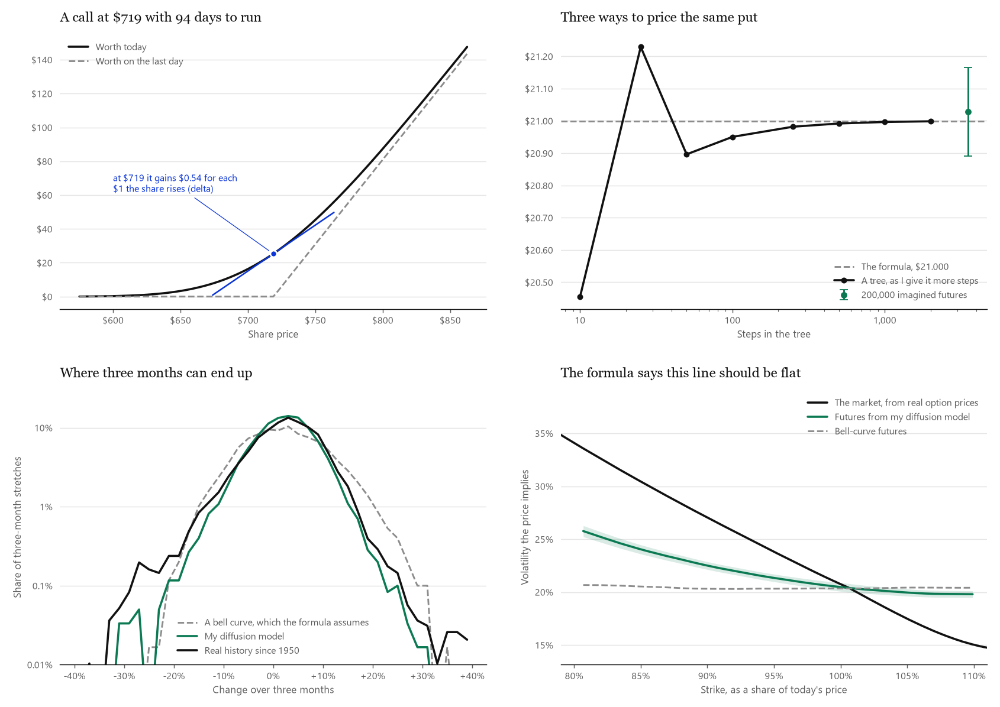

# What is an option worth?

An option is the right to buy or sell a share at a fixed price on a future date, with no duty to use it. There
is a famous formula for what that right is worth, called Black-Scholes. I priced options with it and with two
other methods, measured how the price reacts to everything it depends on, and then tested the formula against
what people really pay.

Three parts come from earlier in this repository, where I wrote them by hand:

- The [autograd engine from project 2](../2_autograd) works out the Greeks. I did not type in a formula for any
  of them.
- The [diffusion model from project 4](../4_diffusion), which used to draw handwritten digits, makes up futures
  for the stock market. I priced options on those futures.
- The [Adam optimizer from project 1](../1_optimizers) takes over when the standard solver for implied
  volatility fails.

[Open the interactive pricer](https://aopejf.github.io/ml-from-scratch/options/)



This is a worked method and I am not suggesting anyone trade on it. The prices are real and public: the S&P 500
since 1950, and one day of quotes (2026-11-24) for options on SPY, the fund that tracks it.

## The Greeks from my own engine

The Greeks say how far an option's price moves when the share price, time, volatility or the interest rate
moves. Textbooks derive a separate formula for each. I wrote the price formula once using the engine's numbers,
and one backward pass returned all of them. Across 1,000 random options the largest gap from the textbook
formulas is 1e-15, which is the last decimal place a computer holds.

## Three ways to the same price

A three-month put on SPY at $719, at 16% volatility:

| Method | Price |
|---|---|
| The Black-Scholes formula | $20.9998 |
| A tree of 1,000 up and down moves | $20.9987 |
| The average over 200,000 imagined futures | $21.03, give or take $0.07 |

The formula only handles an option you must hold to the end. The tree can also price one you may use early, by
asking at every step whether using it now beats waiting. That right adds $0.38 to this put.

## Where the formula is wrong

The formula takes one volatility for the share, whatever the option. I ran it backwards on 303 real quotes to
find the volatility each price implies, and the answers differ a lot. Options that pay out if the market falls
10% imply 27.1%. Options at today's price imply 20.4%, and options on a 5% rise imply 17.5%. This tilt is called
the volatility smile.

In money, a put at $645 costs $10.62. Given the volatility at today's price, the formula says $4.72. Buyers pay
2.3 times the formula for protection against a crash.

## Futures from a model that used to draw digits

The formula assumes every day's move comes from the same bell curve. Real markets have bad days far bigger than
a bell curve allows, and the bad days come in runs.

I gave project 4's diffusion recipe a different picture to learn: 64 days of market moves laid out as an 8 by 8
grid, for all 19,283 three-month stretches of the S&P 500 since 1950. Then I asked it for 6,000 new ones. Two
came out broken, with a single day worse than any on record, and I threw those away.

| In a three-month stretch | Real S&P 500 | Diffusion model | Bell curve |
|---|---|---|---|
| Yearly volatility | 15.8% | 13.6% | 15.8% |
| Days with a move over 3 times the typical | 1.40% | 1.36% | 0.27% |
| Do big days follow big days? (0 means no) | 0.07 | 0.06 | -0.02 |
| Wildest stretches against calmest | 3.8 | 3.5 | 1.3 |
| Stretches losing over 10% | 5.2% | 3.0% | 5.8% |
| Stretches losing over 20% | 0.93% | 0.32% | 0.15% |

The bell curve produces a 20% fall about 6 times less often than history did, and it has no runs of wild days.
The diffusion model has both the wild days and the runs. It is still calmer than history overall and makes fewer
deep falls. Its futures are new ones, too: a generated stretch is about as far from its nearest real stretch
(0.055) as real stretches are from each other (0.055).

## Pricing on those futures

Priced on the diffusion model's futures, crash protection comes out dearer than the formula says, which is the
direction the market leans. The model accounts for 32% of the market's tilt. It puts the $645 put at $6.43,
between the formula's $4.72 and the market's $10.62. Bell-curve futures account for none of the tilt.

I did not expect it to reach the market's price. Much of the rest is what buyers pay to be rid of risk, and a
model that has only seen past prices cannot know that.

## When the solver fails

Finding the volatility behind a price is normally done with Newton's method, using the slope from the engine. On
the 303 real quotes it solved 299. The other 4 had prices that no volatility can produce.

I also made 1,000 deliberately awkward options: far from the strike, very short, or very volatile. Newton solved
394 of them. Project 1's Adam solved the other 542 that had an answer, each to within a millionth of a dollar of
its price.

## Official terms

| Plain English | Official term |
|---|---|
| The right to buy / to sell | Call / put |
| The fixed price in the contract | Strike |
| How far the option moves when the share moves $1 | Delta |
| How fast delta itself changes | Gamma |
| What one more point of volatility adds | Vega |
| What one day passing costs | Theta |
| What one more point of interest adds | Rho |
| The tree of up and down moves | Binomial tree (Cox-Ross-Rubinstein) |
| Averaging over imagined futures | Monte Carlo simulation |
| An option usable only at the end / at any time | European / American |
| The volatility that explains a market price | Implied volatility |
| Implied volatility changing with the strike | Volatility smile, or skew |
| Pricing as if shares earn only the safe rate | Risk-neutral pricing |
| Getting slopes from the code that computes the price | Automatic differentiation |
| Crashes being commoner than a bell curve says | Fat tails |
| Wild days arriving in runs | Volatility clustering |

## What is in the folder

| File | What it does |
|---|---|
| [`fetch_data.py`](fetch_data.py) | Downloads the S&P 500 history and one day of SPY option quotes (Yahoo Finance) and the interest rate (FRED) |
| [`options.py`](options.py) | The formula on my engine, the Greeks, the tree, pricing from futures, and implied volatility with its fallback |
| [`scenarios.py`](scenarios.py) | Trains project 4's diffusion recipe on three-month stretches of the market and makes new ones |
| [`analysis.py`](analysis.py) | Runs every comparison and writes the chart and the page's data |
| [`pricer.js`](pricer.js), [`page.html`](page.html) | The interactive pricer, with the same sums in JavaScript |

The Black-Scholes formula is written with the `Value` numbers from project 2's engine (`2_autograd/engine.py`).
Calling `backward()` on the price gives delta, vega, theta and rho at once, and gamma is the same trick applied
to delta. I added three small operations to the engine for this: e to a power, and the area and height of the
bell curve.

Project 4's noise schedule, training target and 1,000-step generator (`4_diffusion/diffusion.py`) are imported
and used unchanged. Only the network inside is new, because 64 days are a sequence and a digit is a picture.

When a Newton step throws the guess out of range, project 1's Adam (`1_optimizers/optim.py`) shrinks the squared
price error instead. Adam steps by the direction of the slope and ignores its size, so a nearly flat slope does
not stop it.

## Run it

```
pip install numpy pandas matplotlib yfinance requests torch
python fetch_data.py            # today's prices; the numbers above will change with the date
python scenarios.py train       # about 8 minutes (a trained model is included)
python scenarios.py generate    # about 35 minutes for 6,000 futures
python analysis.py              # writes results.json, result.png and the page
```

The downloaded prices are not stored in this repository. `fetch_data.py` recreates them.

## Checks

`tests/test_options.py` checks against answers known in advance: a worked example from the standard textbook,
the no-free-money link between calls and puts, the engine's Greeks against the textbook formulas and against
simply nudging each input, the tree closing in on the formula, bell-curve futures reproducing the formula's
price, implied volatility returning the volatility that made the price, and the Adam fallback on options Newton
cannot solve. It also checks that the new network runs through project 4's generator untouched.
`tests/check_options.js` reruns the page's JavaScript and fails if it differs from Python.

## Limits

- Past prices cannot explain the whole smile, for the reason given above. I would be suspicious of a model like
  this one that claimed to.
- The generated futures are calmer than history (13.6% a year against 15.8%) and have fewer deep falls. I
  stretch them to the market's own volatility before pricing, so the comparison is about shape only.
- The futures do not know today. Each one is a typical three months from any time since 1950, and none is a
  forecast from the current market.
- I used one day of quotes and one contract date. The smile changes daily.
- The quotes are for American options and the formula is for European ones. For the options used here, the
  cheaper side of each strike, the difference is small.
- The model sometimes makes a broken future. I removed 2 of 6,000 with a fixed rule (no day over 25%). A model
  trained for longer should make fewer.
- The model is small and briefly trained: 59,105 numbers and 5,000 steps on a laptop.
- Black-Scholes also assumes constant interest, no trading costs and continuous trading.

Prices from Yahoo Finance. Interest rate from FRED, Federal Reserve Bank of St. Louis.
