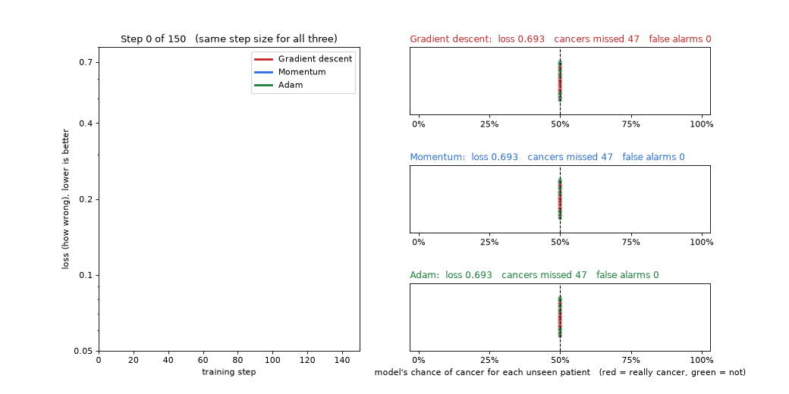

# Optimizers from scratch

Gradient descent, momentum and Adam written in plain NumPy, then used to train a real model.



## What this shows

Three identical tumour classifiers (from `0_logistic_regression`) start out knowing nothing.
Each is trained by a different optimizer with the same step size (0.05).

| After 150 steps | Loss |
|---|---|
| Gradient descent | 0.112 |
| Momentum | 0.065 |
| Adam | 0.062 |

Gradient descent is still catching up at step 150. Momentum and Adam are nearly done by step 30.

On the right, every dot is a patient the model never trained on. All of them start at 50%.
Learning pulls cancers (red) to the right and non-cancers (green) to the left.

## Files

- `optimizers.py`: the three rules on a toy valley, with the paths drawn (`result.png`). Also shows training "exploding" when the step size is too big.
- `optim.py`: the same three rules as reusable classes. Each has one method, `step(params, grads)`, the same shape PyTorch uses.
- `watch_training.py`: trains the tumour classifier with all three, live.

## Run it

```powershell
python watch_training.py
```

That opens a window that updates after every training step. Add `--save` to write `training.gif` instead.

## Limits

- All three end up at the same answer if you wait long enough. This problem has one lowest point, so the optimizer changes the speed, not the destination.
- A lower loss is not the same as fewer mistakes. At step 150 gradient descent has the highest loss and misses 3 cancers at the 50% cut-off, while the other two miss 4. The difference is one patient sitting near the line.
- One step size was used for all three. Each could be tuned to go faster.
