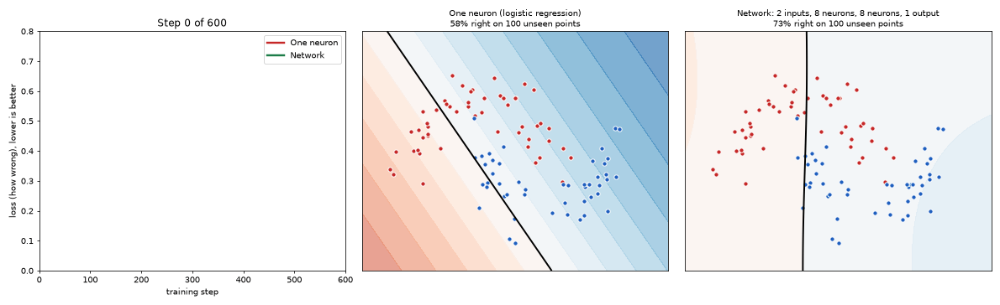

# Autograd engine from scratch

A tiny version of the part of PyTorch that works out gradients automatically,
written in plain Python, then used to train a neural network.



## What it does

Every number is wrapped in a `Value` that remembers which numbers it was made from.
Doing maths with Values builds a record of every step. Calling `.backward()` on the
final loss walks that record in reverse and tells every weight which way to move.

No gradient formula is written by hand anywhere. Change the model and the gradients
still come out right.

## Result

Two interlocking crescents of points, 200 to train on and 100 held back.

| Model | Weights | Right on unseen points |
|---|---|---|
| One neuron (logistic regression) | 3 | 89% |
| Network, 2 → 8 → 8 → 1 | 105 | 97% |

One neuron can only draw a straight line. The network bends the line around the crescents.

## How I know the gradients are right

`checks.py` runs four checks:

1. A sum small enough to follow by hand, `(a*b + c)²`, with every step printed.
2. For one neuron, the engine arrives at "prediction minus truth, times the input", the formula derived by hand in `0_logistic_regression`, without being told it.
3. All 105 weights of a network, compared against brute-force measurement. Biggest difference: 1e-10.
4. The tumour classifier from `0_logistic_regression` trained with the engine instead of the hand-written formula. It lands on the same loss, 0.0624, as the NumPy version in `1_optimizers`.

## Files

- `engine.py`: the `Value` class and `backward()`. About 60 lines of logic.
- `nn.py`: neurons, layers and networks built from Values.
- `checks.py`: the four checks above.
- `train.py`: trains one neuron and a network side by side, saves `result.png` and `training.gif`.

The optimizer is Adam from `1_optimizers/optim.py`.

## Run it

```powershell
python checks.py
```

```powershell
python train.py --live
```

`--live` opens a window that updates as the network trains. Training takes a bit over a minute.

## Limits

- It is slow. Every single number is its own Python object, so 600 steps on 200 points takes over a minute. PyTorch does the same maths on whole grids of numbers at once, which is why the next projects use it.
- The crescents are practice data made by a formula, chosen because the whole problem fits in one picture. Check 4 uses real data.
- The network scores 99.5% on its training points and 97% on unseen ones, and it has drawn a small island around one stray point. That is mild memorising, the same risk as in project 0.
- The loss sits on a plateau until about step 220, then drops sharply. With a different random start the timing would differ.
