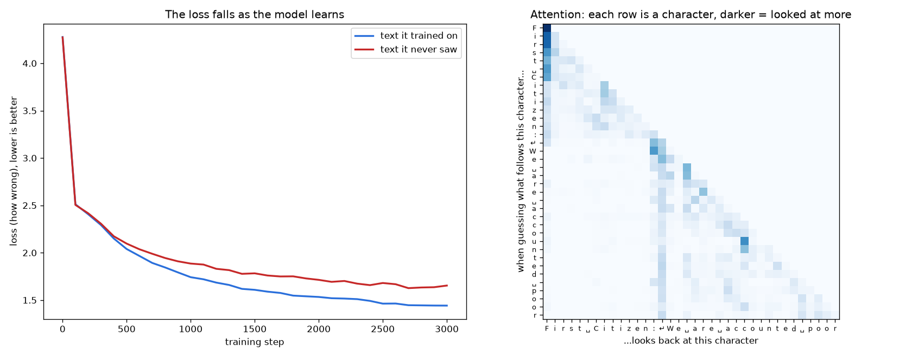

# Mini GPT from scratch

A small decoder-only transformer, written in PyTorch with the attention mechanism
implemented by hand, trained to write fake Shakespeare one character at a time.



## Result

Trained for 3,000 steps on a laptop processor. Loss is cross-entropy on next-character prediction.

| Step | Loss on unseen text | What it writes |
|---|---|---|
| 0 | 4.27 | `YYpJ m-!dD'Sz N M vextwsnVxMXLB3KawGlZf;BseGr$g?zxaIj3xF-Smj` |
| 100 | 2.50 | `Hot po ce sin s ars, thanayovened n` |
| 300 | 2.31 | `POLO: Dor s menondee t? 'd lat wa gr heshend fan` |
| 1000 | 1.89 | `COMINIUS: Not evear of if you, a mastords,` |
| 3000 | 1.65 | `POMPEY: You shall no be like you. CLAUDIO: Come, my lord.` |

A loss of 4.17 is what blind guessing among 65 characters scores. Full samples are in `samples.md`.

Nobody told the model what a word, a line or a play is. Character names in capitals, colons,
line breaks and common words all emerge from predicting the next character.

## How it works

1. **Tokenize.** Each of the 65 distinct characters becomes a number.
2. **Embed.** Each character, and each position, becomes a list of 128 numbers.
3. **Self-attention.** Every character produces a query, a key and a value. Its query is compared
   with the keys of all earlier characters (a dot product), softmax turns the scores into weights,
   and it takes a weighted mix of their values. A mask stops it looking at later characters.
4. **Stack.** Four of these blocks, each with four attention heads and a small feed-forward network.
5. **Predict.** A final layer outputs a probability for each possible next character.

The model has 824,897 parameters. The training loop is the same guess, score, nudge loop as the
earlier projects: cross-entropy loss, backpropagation, and the Adam optimizer (AdamW).

The right-hand picture shows what the last layer's attention looks at for one phrase. Each row is
a character, and darker cells are the earlier characters it leaned on. The lower-left triangle
is the only part filled in, because of the mask.

## Files

- `gpt.py`: the model. `SelfAttention` is written out step by step; PyTorch's ready-made attention layer is not used.
- `train.py`: trains it, printing a short writing sample every 10 steps.
- `generate.py`: makes the trained model write more.
- `samples.md`: writing samples from six points in training.
- `data/shakespeare.txt`: about 1 MB of Shakespeare's plays (the "tiny Shakespeare" file from Andrej Karpathy's char-rnn repository).

## Run it

```powershell
python generate.py "ROMEO:"
```

```powershell
python train.py
```

## Limits

- It produces the look of Shakespeare, not the sense. Many words are real, the sentences mean nothing.
- It works on single characters and can only see the previous 128 of them.
- It had not finished improving at step 3,000. The loss on unseen text was still falling slowly.
- The gap between the loss on training text (1.44) and unseen text (1.65) shows it has started to fit its training text more closely than text in general.
- Training took 104 minutes on a laptop processor that was also running another job. On its own it runs at roughly 3 steps per second.
