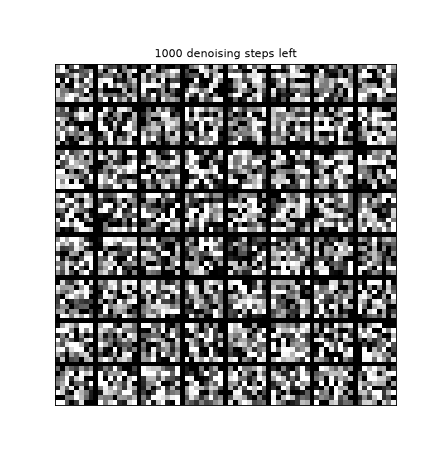
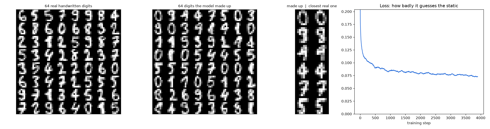
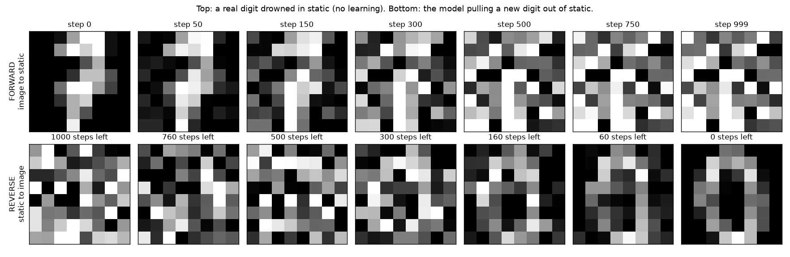

# Diffusion model from scratch

A small denoising diffusion probabilistic model (DDPM), written in PyTorch, that generates
new handwritten digits out of random static.



## Result



The left grid is real handwriting. The second grid was made by the model from pure static.
Most are readable digits; a few are smudges that are not any digit.

## Is it inventing or copying?

For every generated digit I found the most similar training digit and measured how different
they are. I did the same for 200 real digits the model never saw.

| | Typical distance to the closest training digit | Smallest |
|---|---|---|
| Generated digits | 2.08 | 1.52 |
| Real held-back digits | 2.00 | 0.94 |

Generated digits are about as far from the training set as genuinely new handwriting is.
If the model were copying, its distances would be close to zero.

## How it works



1. **Forward process (no learning).** Take a real image and add a little Gaussian noise, 1,000 times,
   following a fixed schedule. By the end only static is left.
2. **Training.** Pick a real digit and a random step, add that much noise, and ask the network
   to say what the noise was. The loss is the mean squared error between its guess and the real noise.
3. **Reverse process.** Start from pure static. Ask the network where the noise is, remove a
   little of it, and repeat 1,000 times.

The network is a small U-Net with 844,289 parameters. It is told which step it is looking at,
because spotting noise in a nearly clean image is a different job from spotting it in near-static.

The training loop is the same as every earlier project: guess, score, backpropagate, update with Adam.

## Files

- `diffusion.py`: the noise schedule, the U-Net, and the sampling loop.
- `train.py`: trains the model, generates 64 digits, runs the copying check, and saves the pictures.

## Run it

```powershell
python train.py
```

## Limits

- The images are 8 by 8 pixels. That is what lets it train on a laptop, and it is why they look blocky. The method is the same at any size; only the cost changes.
- Only 1,597 training images. A larger set, such as the 60,000-image MNIST, would give cleaner digits.
- You cannot ask for a particular digit. It produces whichever digit the static happens to lead to.
- Generating is slow: 1,000 network passes per batch of images.
- The copying check uses plain pixel distance, which is a rough measure of similarity.
- Training took 28 minutes on a laptop processor that was also running another job.

## Data

Optical Recognition of Handwritten Digits (E. Alpaydin and C. Kaynak, 1998, UCI Machine
Learning Repository), loaded through `sklearn.datasets.load_digits`.
