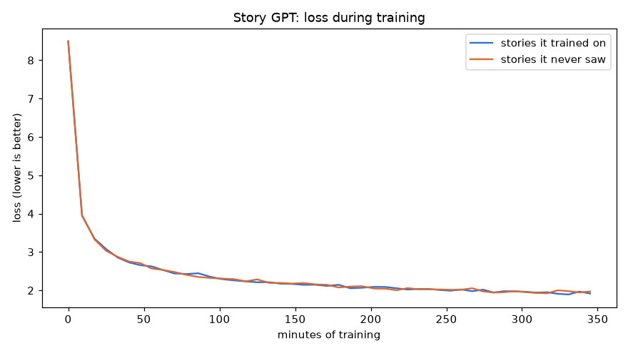

# Story GPT: a language model built and trained end to end

A small GPT that writes children's stories. Everything is written from scratch: the tokenizer
(byte-pair encoding), the transformer with hand-written self-attention, the training loop, and a
web page you can type into. It was trained on a laptop processor in one night, with no graphics card.

## Result

Prompt in bold, the rest written by the model:

> **Once upon a time, there was a little dinosaur who** lived in a small town. The dinosaur liked to go
> on adventures and play in the park. The kids liked to play together. One day, they saw a big red truck.
> The truck was very loud and loud. The dinosaur wanted to play with the truck. [...] The kids were happy
> to play with the dinosaur. They all played together and had fun.

It writes grammatical sentences, keeps a character through a story, and usually finds an ending.
It still loses the plot in the middle. `samples.md` shows the same prompt at eight points in training,
from random word pieces to this.



## Before and after

| | Project 3: mini GPT | This project |
|---|---|---|
| Reads text as | single letters (65 of them) | word pieces (4,096, learned by my own tokenizer) |
| Training text | 1 MB of Shakespeare | 400 MB of short stories (512,000 stories) |
| Parameters | 0.8 million | 3.4 million |
| Text one context window covers | 128 letters | about 500 letters |
| Training | 3,000 steps | 11,748 steps, 6.5 hours |
| Output | Shakespeare-shaped words, no meaning | Simple stories with characters and endings |

The attention code is the same file in both (`3_mini_gpt/gpt.py`). The gains came from the tokenizer,
more data, and a bigger model trained for longer.

Loss fell from 8.52 to 1.95 on stories the model never saw. Loss on its training stories was 1.93, so it
learned general patterns and did not memorise. (The two projects' loss numbers cannot be compared with
each other: guessing 1 letter of 65 is an easier task than guessing 1 piece of 4,096.)

## Scored test

Loss says how well it guesses the next piece, not whether the stories hold together. So `evaluate.py` takes the
openings of 200 stories the model never saw, has the model write each ending, and scores them with the same
checks as the real endings:

| | This model | Real stories |
|---|---|---|
| Finishes the story (reaches an ending before the length limit) | 96% | 100% |
| Keeps the hero (the named character from the opening is still in the ending) | 93% | 98% |
| Repeats itself (share of four-word phrases it had already used) | 1% | 1% |
| New names introduced per story | 0.8 | 0.6 |
| Length in words | 125 | 130 |

On structure it is close to the real thing. These checks cannot see whether a story makes sense, and reading
the endings in [`evaluation.md`](evaluation.md) shows that is where it falls short: events do not follow from each other.

```powershell
python evaluate.py
```

## How it works

1. **Tokenizer** (`tokenizer.py`). Starts with single bytes, then repeatedly glues together the most common
   neighbouring pair until there are 4,096 pieces. Common words become one piece (` dinosaur`), rare ones
   several (`pan|c|ake|s`). On average one piece covers 4 letters.
2. **Model** (`model.py`). A decoder-only transformer: 4 layers, 6 attention heads, width 192, context of 128 pieces.
3. **Training** (`train.py`). Show it 128 pieces, ask for the next one at every position, score with cross-entropy,
   backpropagate, update with AdamW. The learning rate warms up, then follows a cosine curve down. Training runs to a
   time limit and saves a checkpoint every 10 minutes so it can resume.
4. **Writing** (`model.py`, `write`). Feed in the prompt, draw the next piece from the model's top 40 guesses, repeat.

## Try it

```powershell
python demo.py
```

Then open http://localhost:8000. Type the start of a story and watch it write. The page also shows the odds
the model gave to each possible next piece. It runs entirely on your computer.

Or in the terminal:

```powershell
python generate.py "Lily found a shiny key in the garden."
```

## In your browser

**[Try it here](https://aopejf.github.io/ml-from-scratch/)**: nothing to install, and nothing you type leaves your computer.

There is no server behind that page. The model's arithmetic is written a second time, in plain JavaScript with
no libraries (`docs/story-model.js`): the tokenizer, attention, and sampling. `export_web.py` packs the trained
numbers into a 7 MB file the page downloads.

The JavaScript version is checked against the Python one on every change: same word pieces, and next-piece odds
that agree to within 0.002 of a percentage point.

```powershell
python export_web.py
```

```powershell
node ../tests/check_web_model.js
```

One difference: when a story passes the model's 128-piece memory, the page keeps the most recent 64 pieces and
carries on, where the Python version re-reads the last 128 for every new piece. That keeps it fast in a browser.

## A bigger model on a free graphics card

`train_colab.ipynb` trains a model four times the size (13.9 million parameters, context of 256 pieces) on
Google Colab's free graphics card in about 2.5 hours:
[open it in Colab](https://colab.research.google.com/github/aopejf/ml-from-scratch/blob/main/5_story_gpt/train_colab.ipynb).
`train.py --big` is the same trainer; it uses a graphics card when there is one.

## Train it yourself

Get the data (TinyStories, about 420 MB for the part used here):

```powershell
curl.exe -L -o data/valid.txt https://huggingface.co/datasets/roneneldan/TinyStories/resolve/main/TinyStoriesV2-GPT4-valid.txt
```

```powershell
curl.exe -L -r 0-419430399 -o data/train_part.txt https://huggingface.co/datasets/roneneldan/TinyStories/resolve/main/TinyStoriesV2-GPT4-train.txt
```

Then learn the tokenizer and convert the text (2 minutes), and train (6.5 hours):

```powershell
python prepare_data.py
```

```powershell
python train.py 6.5
```

## Files

- `tokenizer.py`: byte-pair encoding, from scratch.
- `prepare_data.py`: learns the tokenizer and turns the stories into numbers.
- `model.py`: builds the model and writes text with it.
- `train.py`: time-limited training with checkpoints.
- `generate.py`, `demo.py`, `demo.html`: ways to use the trained model.
- `evaluate.py`, `evaluation.md`: the scored test and its results.
- `export_web.py`, `../docs/`: the version that runs in a browser with no server.
- `train_colab.ipynb` (written by `make_notebook.py`): trains the bigger model on a free graphics card.
- `model.pt`, `tokenizer.json`: the trained model and its tokenizer.
- `samples.md`: the same prompt at different points in training.

## Limits

- It only knows the world of simple children's stories. Ask about anything else and it turns it into one.
- Stories drift: characters appear from nowhere and objects change. A model this small, trained this briefly, cannot
  track a plot. The TinyStories authors got coherent plots from models a few times larger trained far longer on graphics cards.
- It saw about 48 million word pieces, less than half of the text I prepared. The loss was still falling when time ran out.
- The model size was chosen to fit one night on a laptop processor (about 2,000 pieces a second), not because it is the best size.
- The scored test measures structure (endings, characters, repetition), not sense. Judging whether a plot is coherent still means reading the stories.
- The graphics-card path of the trainer was tested on a processor only; the bigger model's results are not in yet.

## Data

TinyStories (Ronen Eldan and Yuanzhi Li, 2023): short stories written by GPT-4 using words a young child knows.
