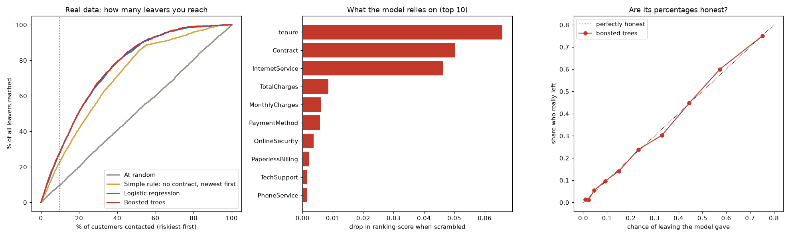

# Predicting membership cancellations

An applied project: a car wash sells monthly memberships and can afford to contact 10% of its
members each month with a "please stay" offer. **Which 10% should it contact?**

The project has two halves: the method on a real public dataset, and the same method on a made-up car wash
list where the true answers are known.

## On real data: 7,043 telecom customers



IBM's public Telco Customer Churn dataset: real customers of a phone and internet company, 26.5% of whom left.
Every customer was scored by a model that never saw them in training (5-fold cross-validation).

| How the 704 customers to contact are chosen | Leavers reached | Hit rate | Ranking score (ROC AUC) |
|---|---|---|---|
| At random | 183 | 26% | 0.51 |
| Simple rule: no contract, newest customers first | 432 | 61% | 0.78 |
| Logistic regression | 530 | 75% | 0.85 |
| Gradient-boosted trees | 529 | 75% | 0.85 |

- Of the customers the model picks, **3 in 4 really were about to leave**. Picking at random, it is 1 in 4.
- The model beats the sensible rule of thumb by 23%: 98 more leavers reached for the same number of calls.
- Logistic regression ties the more complex model, so the simple, explainable one is the right choice here.
- It leans on how long someone has been a customer, their contract type, and their internet service. Those match what the simple rule already guessed, plus detail the rule misses.

Run it:

```powershell
curl.exe -L --create-dirs -o data/telco.csv https://raw.githubusercontent.com/IBM/telco-customer-churn-on-icp4d/master/data/Telco-Customer-Churn.csv
```

```powershell
python telco.py
```

## On made-up data: a car wash membership

> **All the data in this half is made up.** `make_data.py` invents 20,000 members. No real customers
> or business are involved. That keeps the project shareable, and it means the true reasons
> for cancelling are known, so the model can be checked against them.

### Result


Tested on 5,000 members the models never saw, 425 of whom cancelled:

| How the 500 members to contact are chosen | Cancellers reached | Ranking score (ROC AUC) | Estimated profit |
|---|---|---|---|
| At random | 40 (9%) | 0.50 | -$431 |
| Simple rule: fewest washes last month | 111 (26%) | 0.71 | $3,420 |
| Logistic regression | 136 (32%) | 0.76 | $5,202 |
| Gradient-boosted trees | 151 (36%) | 0.76 | $5,975 |

- Contacting people at random loses money: the offers cost more than they save.
- The model reaches about **3.8 times as many cancellers as random** and 36% more than the simple rule.
- Logistic regression (project 0's model) does nearly as well as the more complex model. That is common on
  table data, and worth knowing: the simple model is easier to explain to the people who act on it.

## Did it find the real reasons?

Because the data is made up, the real reasons are written in `make_data.py`. The model was not told them.

- It ranked **washes last month** and **months as a member** highest. Those are the two strongest real causes.
- It picked up **declined cards** and **complaints**, which are rare but strong.
- It gave **rainy days** zero weight. That column was put in as a trap: it has no effect on cancelling.
- When the model says a member has a 30% chance of cancelling, about 30% of such members do (right-hand chart).

## The money estimate

The profit column rests on three assumptions set at the top of `churn.py`. Change them to match a real business:

| Assumption | Value |
|---|---|
| Cost of the offer, per member contacted | $5 |
| Share of would-be cancellers the offer saves | 30% |
| Extra months a saved member stays | 6 |

## Files

- `make_data.py`: invents the member list and writes `members.csv`.
- `churn.py`: trains the models, compares them, and saves the picture.

## Run it

```powershell
python make_data.py
```

```powershell
python churn.py
```

Needs `pandas` as well as the packages from the main README: `python -m pip install pandas`.

## Limits

- The car wash data is made up, so that half shows the method works, not that those exact numbers would hold for a
  real business. The telecom half is real but is one company's customers at one moment.
- Even the best model reaches 36% of cancellers at this budget. Much of cancelling is luck the data cannot see;
  that is built into the made-up data on purpose, because real life is the same.
- It predicts who will cancel, not who can be persuaded to stay. Some members will leave whatever you offer, and some
  would have stayed anyway. Measuring that needs an experiment: make the offer to a random half and compare.
- The 30% save rate and 6 extra months are guesses.
