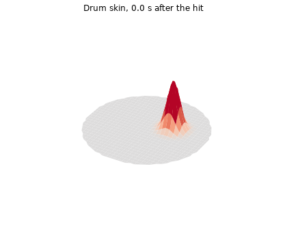
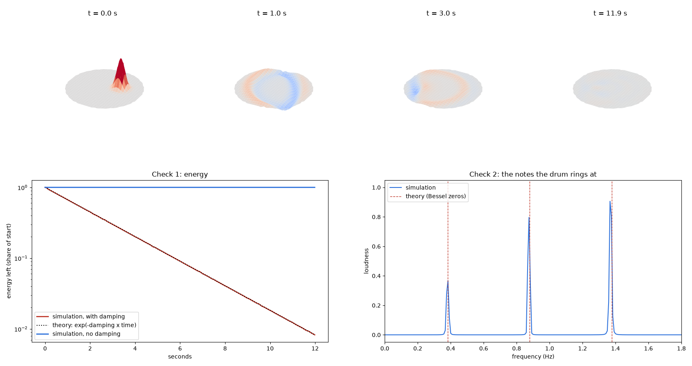

# Wave equation simulator: a vibrating drum skin

A drum skin simulated from its governing equation, the damped wave equation, solved on a 2D grid with
finite differences and animated in 3D. NumPy and matplotlib only.



## The maths

```
u_tt = c² (u_xx + u_yy) − γ u_t
```

`u` is the height of the skin at each point. The equation says: a point's acceleration is proportional to
how curved the skin is there, minus a drag proportional to its speed. `c` is how fast ripples travel and
`γ` is the damping. The rim is clamped at height zero.

## From maths to code

A computer cannot store a smooth skin, so the skin becomes a 121 by 121 grid and time becomes 8.3 ms steps.
Each derivative is replaced by a difference between neighbouring values. Solving for the next moment gives
one line, which is the whole simulation:

```python
u_next = (2 * u - b * u_before + (c * dt) ** 2 * curvature(u)) / a
```

The time step must stay below `dx / (c·√2)` (the CFL condition) or the simulation blows up.

## Does it match real physics?



Two checks against answers that come from pen-and-paper maths, not from this code:

| Check | Theory | Simulation |
|---|---|---|
| With damping off, energy stays constant | change of 0 | change of 1.0e-15 (rounding error) |
| With damping on, energy decays at rate γ = 0.4 | 0.400 | 0.400 |
| Lowest note of a round drum (first Bessel zero) | 0.3827 Hz | 0.3808 Hz (0.51% off) |
| Second note | 0.8785 Hz | 0.8742 Hz (0.50% off) |
| Third note | 1.3773 Hz | 1.3703 Hz (0.51% off) |

The notes are all about 0.5% low for one reason: a circle drawn on a square grid has a stair-step edge,
which makes the drum act very slightly larger than it is. A finer grid shrinks that error.

## Run it

```powershell
python drum.py
```

It takes about a minute, most of it drawing the animation. The drum size, wave speed, damping and where
it is hit are settings at the top of the file.

## Limits

- The stair-step rim, as above. Professional solvers use meshes that follow the curve.
- The simplest time-stepping scheme (explicit, second order). It is accurate here but needs small time steps.
- An ideal skin: uniform tension, small movements, simple air drag. A real drum also has stiffness and the air inside it.
- The frequency check uses a hit at the exact centre, which only excites the circularly symmetric notes.
