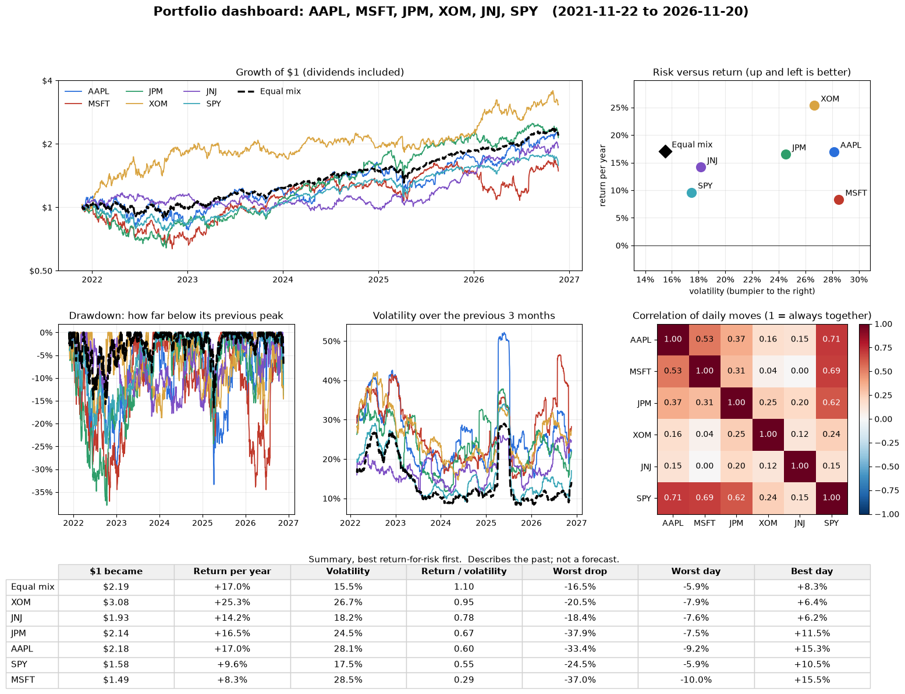

# Stock portfolio dashboard

One page that answers the standard questions about a handful of stocks, from real price data:
returns, volatility, drawdowns, correlations, and risk versus return.



> This describes the past. It is not a forecast and not investment advice.

## The interactive version

```powershell
python app.py
```

Then open http://localhost:8050. Type any 2 to 8 stock symbols, pick 1 to 10 years, and every chart
redraws. Hover over a chart to read exact values; drag to zoom.

It is a small web page (`app.html`, charts drawn with Plotly) served by Python's built-in web server
(`app.py`). Both the page and the picture above get their numbers from the same file, `metrics.py`.

## What each panel answers

| Panel | Question | How it is worked out |
|---|---|---|
| Growth of $1 | How much did each one grow? | Daily % changes multiplied together, dividends included |
| Risk versus return | Was the bumpiness worth it? | Yearly return against yearly volatility |
| Drawdown | How bad did it get? | How far each one sat below its own previous peak |
| Rolling volatility | When was it bumpy? | Spread of daily moves over the previous 3 months, scaled to a year |
| Correlation | Do they move together? | Correlation of daily % changes |
| Summary table | The numbers | Sorted by return divided by volatility (Sharpe ratio with a 0% risk-free rate) |

Everything is computed from one thing, the daily percentage change, in about ten lines of pandas.

## What this data shows (22 Nov 2021 to 20 Nov 2026)

| | $1 became | Return per year | Volatility | Worst drop |
|---|---|---|---|---|
| Equal mix | $2.19 | +17.0% | 15.5% | -16.5% |
| XOM | $3.08 | +25.3% | 26.7% | -20.5% |
| JNJ | $1.93 | +14.2% | 18.2% | -18.4% |
| JPM | $2.14 | +16.5% | 24.5% | -37.9% |
| AAPL | $2.18 | +17.0% | 28.1% | -33.4% |
| SPY | $1.58 | +9.6% | 17.5% | -24.5% |
| MSFT | $1.49 | +8.3% | 28.5% | -37.0% |

The main finding is diversification. The six had an average volatility of 23.9%, but holding equal amounts
of all of them had 15.5%, with a smaller worst drop than any single one. That works because they do not
move in step: the average correlation between pairs is 0.30.

## Run it

```powershell
python dashboard.py
```

Or choose your own stocks:

```powershell
python dashboard.py NVDA KO WMT TSLA
```

Needs `python -m pip install yfinance pandas`. Prices are downloaded once from Yahoo Finance and kept in `data/`.

## Limits

- Five years is one stretch of history. A different five years would rank these differently.
- These stocks were picked today, knowing they survived. That flatters the results (survivorship bias).
- SPY is a fund that already holds the other five, so the equal mix counts them partly twice.
- The equal mix assumes free rebalancing every day: no trading costs, no taxes.
- Volatility treats upswings and downswings as equally bad, and the return-for-risk number ignores what cash would have earned.
- Yahoo Finance data is free and unofficial. It is fine for a dashboard; check it before relying on any figure.
