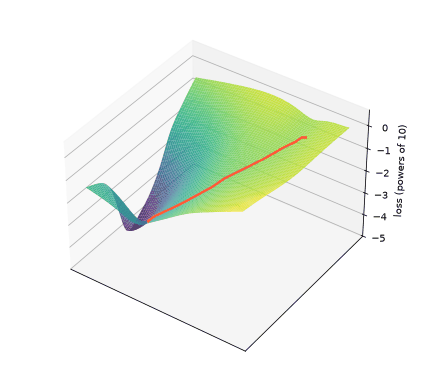
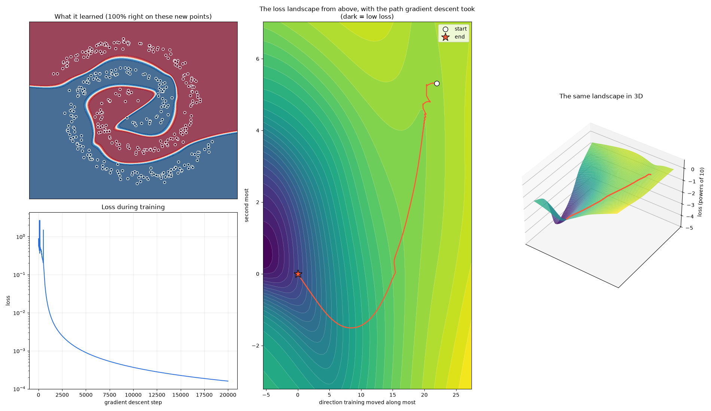

# Neural network in pure NumPy, with its loss landscape

A small neural network written with no machine learning library, then a map of the loss surface it
trained on, with the path gradient descent took drawn on top.



## Result



- **The task:** tell two interleaved spirals apart. No straight line can do it.
- **The network:** 2 inputs, two layers of 16 neurons (tanh), 1 output (sigmoid). 337 parameters.
- **The outcome:** 100% correct on 400 new points it never trained on.
- **The backprop check:** my hand-written gradients match brute-force numerical ones to 1.3e-10.

## How the landscape is drawn

The loss depends on all 337 parameters, so the true landscape has 337 dimensions. To draw it:

1. Save the parameters at every training step. That is the path.
2. Find the two directions the path moved along most (principal component analysis, via SVD).
3. Evaluate the loss on a grid across those two directions. That grid is the surface.
4. Draw the path on it.

Those two directions hold 98.6% of the path's movement, so the flat picture is a fair summary of the real route.

What the picture shows: the path starts on a high plateau, jitters while the step size is too large for
the terrain (the spikes at the start of the loss curve), then finds a valley and follows its floor in a
long curve. The end point is not at the darkest spot. With data this cleanly separable the loss can always
be pushed a little lower, so the valley has no bottom and training was still creeping along it when it stopped.

## What is written by hand

Everything in `neural_net.py`, using only NumPy arrays:

- the forward pass (matrix multiply, tanh, sigmoid)
- cross-entropy loss
- backpropagation, layer by layer, as matrix operations
- gradient descent
- the PCA for the landscape

Project 2 did backpropagation one number at a time. This does the same maths with whole matrices,
which is how real libraries do it and is far faster.

## Run it

```powershell
python neural_net.py
```

## Limits

- The landscape is a 2D slice of a 337-dimensional surface. It is accurate along the path and says nothing about the other 335 directions.
- Plain gradient descent on the full dataset, with no momentum or mini-batches. Project 1 covers the better optimizers.
- A toy problem: 400 points, two features, almost no noise. 100% on new points is expected here and would be suspicious on real data.
- The 3D picture shows loss in powers of ten, so the valley looks steeper than it would on a plain scale.
