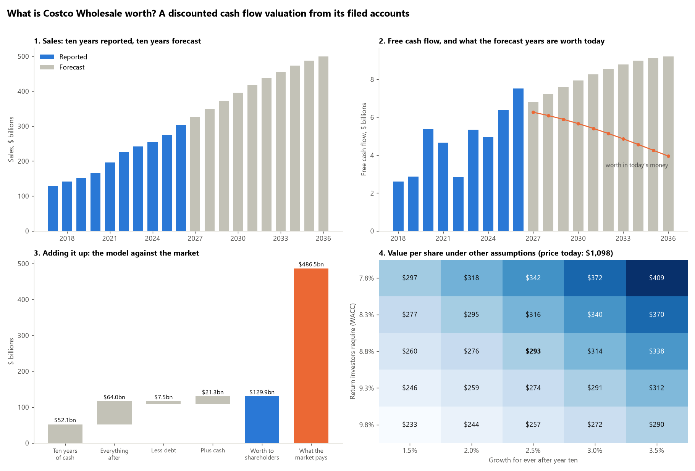
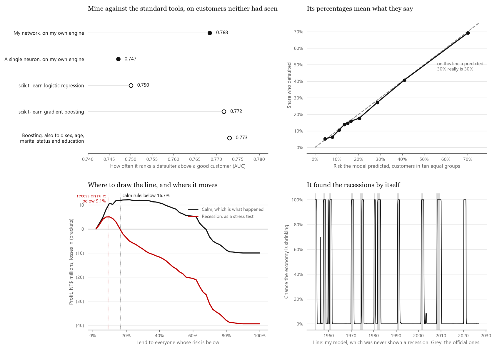

# Machine learning, built from scratch

[](https://github.com/aopejf/ml-from-scratch/actions/workflows/tests.yml)

Ten projects that build machine learning up from a single neuron to a language model you can type into,
with the core parts written by hand instead of called from a library, plus four finance projects, two of which run on
those hand-built parts. Every result below is measured, and
every project says what it cannot do.

## Start with these seven

### 1. A GPT that writes stories, built end to end ([`5_story_gpt`](5_story_gpt))

The tokenizer, the attention, the training loop and the web page are all written from scratch. It trained in one
night on a laptop processor, with no graphics card.

**[Try it in your browser](https://aopejf.github.io/ml-from-scratch/)**

> **Once upon a time, there was a little dinosaur who** lived in a small town. The dinosaur liked to go
> on adventures and play in the park. [...] They all played together and had fun.

- Loss fell from 8.52 to 1.95 on stories it never saw.
- Scored against real stories on 200 unseen openings: [`evaluation.md`](5_story_gpt/evaluation.md).
- The model is also written in plain JavaScript, so the demo runs in your browser with no server, and shows the odds it gave each possible next word.

### 2. Which customers are about to leave? ([`6_membership_churn`](6_membership_churn))

A business can afford to contact 10% of its customers with a "please stay" offer. On 7,043 real telecom customers:

| How the 10% are chosen | Really were about to leave |
|---|---|
| At random | 1 in 4 |
| Sensible rule of thumb | 6 in 10 |
| The model | 3 in 4 |

The simple model (logistic regression) tied the complex one, so the write-up recommends the simple one.

### 3. Handwritten digits out of static, and you choose the digit ([`4_diffusion`](4_diffusion))


A diffusion model, the same kind of model behind image generators. 100 of 100 requested digits came out
readable as the digit asked for, and a check confirms none were copied from the training set.

### 4. Finance pack for a 27-site car wash chain ([`10_car_wash_finance`](10_car_wash_finance))


The work of a financial analyst on a made-up multi-site business: a profit scorecard for every site, the budget miss
explained to the dollar, what a member is worth, a tested forecast, and a build-or-not decision on the next site.

**[Open the dashboard](https://aopejf.github.io/ml-from-scratch/finance/)** | [one-page memo](10_car_wash_finance/MEMO.md) | [Excel model](10_car_wash_finance/car_wash_finance_model.xlsx)

- Found all four problems planted in the data, with a dollar value on the fixable ones, and no false alarms.
- The same model exists in Python, Excel and JavaScript, and the three are checked against each other.

### 5. What is a company worth? ([`11_company_valuation`](11_company_valuation))



A discounted cash flow valuation of a real listed company, built from the accounts it files with the regulator.
It values the business, shows how far the answer moves when the assumptions move, and then works backwards from the
share price to what buyers must be assuming. A method, not advice.

**[Open the interactive valuation](https://aopejf.github.io/ml-from-scratch/valuation/)** | [Excel model](11_company_valuation/company_valuation_model.xlsx)

- The model's answer is about a quarter of the share price, and the page shows exactly which assumptions would close the gap.
- A company growing at one steady rate gets the textbook answer to twelve decimal places; Python, Excel and JavaScript agree.

### 6. Who will miss their next payment? ([`12_loan_default`](12_loan_default))



I trained a model on 30,000 real credit card customers to predict who will miss their next payment. It learns on
the autograd engine from project 2 and the Adam optimizer from project 1, with no machine-learning library. A
second model spots recessions without being told what one is, and tells the first when to lend more strictly.

[Open the interactive page](https://aopejf.github.io/ml-from-scratch/loans/)

- It ranks a defaulter above a good customer 77 times in 100 (AUC 0.768), within half a point of scikit-learn's
  strongest model.
- Lending to everyone lost NT$10.0m. Lending only below the break-even risk made NT$11.5m.
- The recession model found all 11 US recessions since 1953. In a recession the usual rule is expected to lose
  money, and the stricter one is expected to make NT$5.1m.

### 7. What is an option worth? ([`13_options_pricer`](13_options_pricer))


I priced options three ways and tested the famous formula against what people really pay. The autograd engine
from project 2 works out the Greeks, so I never typed in a Greek formula. The diffusion model from project 4,
which used to draw digits, makes up futures for the stock market to price options on.

[Open the interactive pricer](https://aopejf.github.io/ml-from-scratch/options/)

- The engine's Greeks match the textbook formulas to 15 decimal places on 1,000 random options.
- People pay 2.3 times what the formula says for crash protection. Futures from the diffusion model account for
  about 32% of that tilt in the market's prices. Bell-curve futures account for none of it.
- When the standard solver for implied volatility fails, project 1's Adam takes over. 542 of 1,000 awkward
  options needed it, and it solved every one.

## All fourteen

| # | Folder | Official name | What it does | Result |
|---|--------|---------------|--------------|--------|
| 0 | [`0_logistic_regression`](0_logistic_regression) | Logistic regression | Spots cancerous tumours from 30 measurements | 97.4% on unseen patients, matches scikit-learn exactly |
| 1 | [`1_optimizers`](1_optimizers) | SGD, momentum, Adam | Three ways of adjusting a model to reduce its mistakes | Momentum and Adam reach in 30 steps what plain descent has not reached in 150 |
| 2 | [`2_autograd`](2_autograd) | Automatic differentiation (backpropagation) | Works out the adjustments automatically for any model | Gradients correct to 1e-10; a small network scores 97% where one neuron scores 89% |
| 3 | [`3_mini_gpt`](3_mini_gpt) | Decoder-only transformer | Learns to write fake Shakespeare, one character at a time | Loss 4.27 to 1.65 on unseen text |
| 4 | [`4_diffusion`](4_diffusion) | Denoising diffusion model (DDPM), class-conditional | Generates handwritten digits out of random static, and you choose the digit | 100 of 100 requested digits readable, none copied |
| 5 | [`5_story_gpt`](5_story_gpt) | GPT with a byte-pair-encoding tokenizer | Writes children's stories; includes a page you can type into | Loss 8.52 to 1.95 on unseen stories after one night on a laptop |
| 6 | [`6_membership_churn`](6_membership_churn) | Churn prediction | Picks which customers to contact before they leave | 75% of its picks really left, against 26% at random (real data) |
| 7 | [`7_wave_equation`](7_wave_equation) | Damped wave equation, finite differences | Simulates a vibrating drum skin and animates it in 3D | Energy conserved to 1e-15; rings within 0.5% of the textbook frequencies |
| 8 | [`8_portfolio_dashboard`](8_portfolio_dashboard) | Portfolio risk analytics | An interactive dashboard of returns, volatility, drawdowns and correlations for any stocks | An equal mix of six holdings had 15.5% volatility against a 23.9% average |
| 9 | [`9_neural_net_numpy`](9_neural_net_numpy) | Multilayer perceptron, loss landscape (PCA) | A neural net in pure NumPy, with a map of the path training took | 100% on new points; hand-written gradients correct to 1e-10 |
| 10 | [`10_car_wash_finance`](10_car_wash_finance) | Unit economics, variance analysis, NPV and IRR | A finance pack for a made-up 27-site chain: scorecard, budget bridge, forecast, investment decision | Finds every planted problem; Excel, Python and JavaScript agree |
| 11 | [`11_company_valuation`](11_company_valuation) | Discounted cash flow (DCF), WACC, reverse DCF | Values a real company from its filed accounts and shows what its share price assumes | $293 a share against a price of $1,098; the price needs 42% growth or an 11.5% margin |
| 12 | [`12_loan_default`](12_loan_default) | Credit scoring (PD, expected loss), hidden Markov model, stress test | Scores real credit card customers on the hand-built engine, and tightens lending when an unsupervised model detects a recession | AUC 0.768 against 0.772 for gradient boosting; all 11 recessions found; the fallback rule turns a loss into NT$5.1m |
| 13 | [`13_options_pricer`](13_options_pricer) | Black-Scholes, the Greeks, binomial tree, Monte Carlo, implied volatility | Prices options three ways, gets the Greeks from the autograd engine, and prices on futures made by the diffusion model | Greeks correct to 1e-15; diffusion futures explain 32% of the market's volatility smile |

Projects 0 to 6 are in order because each one uses the ideas from the ones before. Projects 7 to 11 stand alone.
Projects 12 and 13 put the parts built in projects 1, 2 and 4 to work.

## The one idea behind all of them

Every model here learns the same way:

1. **Guess.** The model makes a prediction using some adjustable numbers (weights).
2. **Score.** A loss function says how wrong the guess was. Lower is better.
3. **Nudge.** Work out which direction to change each weight to make the loss smaller, and move a little that way.
4. **Repeat** thousands of times.

## How they connect

- **Project 0** does all four steps by hand and supplies the loss (cross-entropy).
- **Project 1** is about step 3: better ways to nudge. It trains project 0's classifier.
- **Project 2** automates the "which direction" part. It uses project 1's Adam and rediscovers project 0's gradient formula.
- **Projects 3 and 4** use the same loop on bigger models, with PyTorch doing the jobs projects 1 and 2 did by hand.
- **Project 5** takes project 3's model and makes it useful: a real tokenizer, 400 times more text, a demo.
- **Project 6** applies project 0's model, and a stronger one, to a business decision.
- **Project 12** trains a lending model on project 2's engine with project 1's Adam, and uses the engine again to explain each score.
- **Project 13** writes an option formula with project 2's engine to get its Greeks, falls back on project 1's Adam when a solver fails, and prices on market futures made by project 4's diffusion recipe.

## Setup

Python 3.12 with:

```powershell
python -m pip install numpy matplotlib scikit-learn pandas yfinance xlsxwriter xlrd
```

```powershell
python -m pip install torch --index-url https://download.pytorch.org/whl/cpu
```

PyTorch is only needed for projects 3, 4 and 5, and for the market scenarios in project 13. Each project's README says how to run it.
Everything here was trained on a laptop processor, with no graphics card.

## Tests

```powershell
python -m pytest
```

98 automatic checks in [`tests`](tests), plus five that compare JavaScript code with its Python original, run on every change (the badge at the top). They test claims the projects
depend on: that backpropagation gives the right gradients, that the GPT cannot see words ahead of the one it is
predicting, that the tokenizer gives back exactly the text that went in, that the portfolio numbers are right
on prices with known answers, that the finance pack's budget bridge adds up to the cent, that the valuation gives the textbook answer for a company
with a known value, that the loan model's reasons add up to its score, and that the option Greeks from the engine match the textbook.
