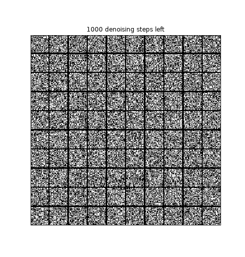

# Machine learning, built from scratch

Seven projects, from a single neuron to a language model you can type into. Each is one folder with its own
code, pictures and README. They are in this order because each one uses the ideas from the ones before.

| # | Folder | Official name | What it does | Result |
|---|--------|---------------|--------------|--------|
| 0 | `0_logistic_regression` | Logistic regression | Spots cancerous tumours from 30 measurements | 97.4% on unseen patients, matches scikit-learn exactly |
| 1 | `1_optimizers` | SGD, momentum, Adam | Three ways of adjusting a model to reduce its mistakes | Momentum and Adam reach in 30 steps what plain descent has not reached in 150 |
| 2 | `2_autograd` | Automatic differentiation (backpropagation) | Works out the adjustments automatically for any model | Gradients correct to 1e-10; a small network scores 97% where one neuron scores 89% |
| 3 | `3_mini_gpt` | Decoder-only transformer | Learns to write fake Shakespeare, one character at a time | Loss 4.27 to 1.65 on unseen text |
| 4 | `4_diffusion` | Denoising diffusion model (DDPM), class-conditional | Generates handwritten digits out of random static, and you choose the digit | 100 of 100 requested digits readable as the digit asked for, none copied |
| 5 | `5_story_gpt` | GPT with a byte-pair-encoding tokenizer | Writes children's stories; includes a page you can type into | Loss 8.52 to 1.95 on unseen stories after one night on a laptop |
| 6 | `6_membership_churn` | Churn prediction (gradient boosting) | Picks which members to contact before they cancel | Reaches 3.8 times as many cancellers as picking at random (made-up data) |



## The one idea behind all of them

Every model here learns the same way:

1. **Guess.** The model makes a prediction using some adjustable numbers (weights).
2. **Score.** A loss function says how wrong the guess was. Lower is better.
3. **Nudge.** Work out which direction to change each weight to make the loss smaller, and move a little that way.
4. **Repeat** thousands of times.

## How they connect

- **Project 0** does all four steps by hand and supplies the loss (cross-entropy).
- **Project 1** is about step 3: better ways to nudge. It trains project 0's classifier.
- **Project 2** automates the "which direction" part. It uses project 1's Adam and rediscovers project 0's gradient formula.
- **Projects 3 and 4** use the same loop on bigger models, with PyTorch doing the jobs projects 1 and 2 did by hand.
- **Project 5** takes project 3's model and makes it useful: a real tokenizer, 400 times more text, a demo.
- **Project 6** applies project 0's model, and a stronger one, to a business decision.

## Setup

Python 3.12 with:

```powershell
python -m pip install numpy matplotlib scikit-learn pandas
```

```powershell
python -m pip install torch --index-url https://download.pytorch.org/whl/cpu
```

PyTorch is only needed for projects 3, 4 and 5. Each project's README says how to run it.
Everything here was trained on a laptop processor, with no graphics card.
